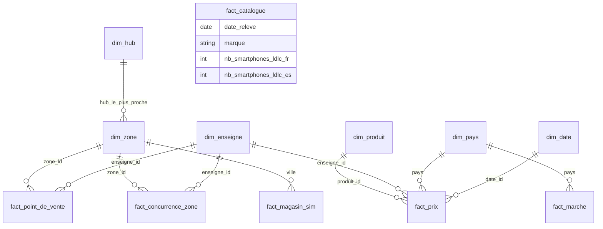

# Modèle de données (Thomas Lefebvre)

Base DuckDB `data/ldlc_espagne.duckdb`, construite par `src/transform/build_star.py`.



`fact_catalogue` est une table d'appoint sans dimension : elle est agrégée par marque et sert uniquement au taux d'éligibilité du catalogue.

## Grain de chaque table de faits

| Table | Une ligne = | Mesures |
|---|---|---|
| fact_prix | un prix relevé, un jour, un modèle, une enseigne, un pays | prix TTC, prix HT, prix barré |
| fact_point_de_vente | un magasin concurrent dans OpenStreetMap | coordonnées, type de commerce |
| fact_concurrence_zone | une ville x une enseigne x un type de commerce | nombre de points de vente |
| fact_marche | un indicateur, un pays, une année | valeur, unité, statut, source |
| fact_catalogue | une marque, un jour de relevé | nombre de smartphones LDLC en France et en Espagne |
| fact_magasin_sim | un poste du compte de résultat simulé | valeur, calcul |

## Choix de modélisation

- **Étoile plutôt que flocon** : peu de dimensions, requêtes simples, lisible dans le dashboard.
- **Clé produit = marque + modèle + capacité + RAM**, pas l'EAN : Apple change de référence selon le pays.
- **Prix stockés en TTC et en HT** : on compare en HT (TVA 20 % contre 21 %), on affiche en TTC.
- **Statut sur chaque donnée de marché** (sourcée, proxy, calcul équipe, hypothèse) : la traçabilité est dans la base.
- **Historisation** : `fact_prix` garde chaque relevé avec sa date ; la vue d'indice prend le plus récent.

## Requêtes types

```sql
-- Indice de prix par famille
SELECT famille, round(avg(indice_es_vs_fr), 1) FROM v_indice_prix GROUP BY famille;

-- Densité concurrentielle par ville
SELECT ville, points_de_vente_pour_100k_hab, distance_route_km FROM v_densite_concurrentielle;

-- Catalogue éligible
SELECT * FROM v_eligibilite_catalogue;
```

## Évolutions prévues

- `dim_zone` par zone de chalandise (isochrone de 20 minutes avec OpenRouteService) au lieu de la commune.
- Appariement des catalogues France et Espagne référence par référence dans `fact_catalogue`.
